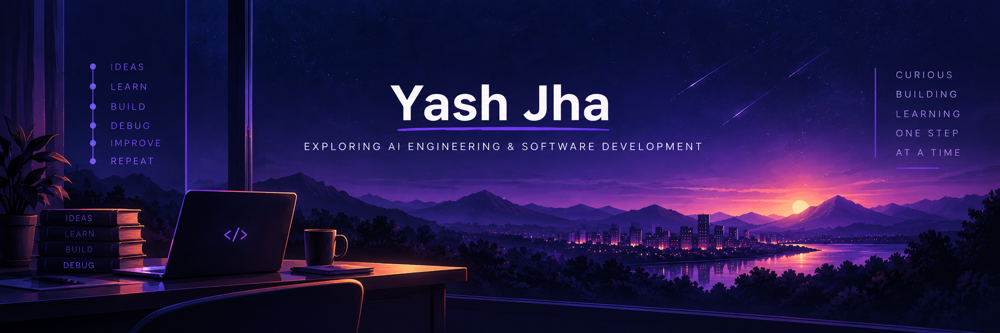

### Exploring AI Engineering & Software Development

*Curious about how systems work. Driven to build and understand them.*

<a href="https://github.com/yashjha247">GitHub</a> ·
<a href="https://www.linkedin.com/in/yash-jha-9652132ab/">LinkedIn</a>

---

## About me

I'm a Computer Science Engineering student interested in **AI engineering, agentic systems, and full-stack development**.

I've explored backend development, RAG-based applications, and AI-assisted prototyping through projects and hackathons. Now, I want to go deeper—understanding how systems are designed, how their components work together, and how to build, test, and improve them.

I'm particularly interested in experimenting with agentic AI architectures while strengthening the software engineering foundations needed to build reliable applications.

I'm here to keep learning, building, and turning curiosity into practical engineering skills.

## Areas of interest

- **AI Engineering:** LLM applications, RAG, agentic workflows, and multi-agent systems
- **Software Engineering:** Backend development, APIs, databases, and full-stack applications
- **Engineering Fundamentals:** Testing, debugging, system design, and architectural trade-offs

## Technologies I've explored

## Selected work

<b>Invoicer — Backend Project</b>

Explored REST APIs, CRUD operations, database modelling, authentication, and validation.

**Stack:** Node.js · Express · TypeScript · MongoDB

[Repository](https://github.com/yashjha247/Invoicer-)

<b>Study Buddy — RAG Application</b>

Explored audio transcription, embeddings, vector search, and LLM-powered question answering.

**Technologies:** Python · Faster-Whisper · ChromaDB · Cohere · Streamlit

[Repository](https://github.com/yashjha247/Study_buddy)

<b>Hackathons & Team Projects</b>

- **Avinya 2026:** Explored drone-delivery simulation and 3D design with a team.
- **Smart India Hackathon 2025:** Participated in two problem statements selected for the college internal round.
- **CIA Ideathon 2025:** Third place as part of a team.

## What I'm working toward

Understanding the fundamentals, experimenting with ideas, debugging what breaks, and learning to make better engineering decisions.

> Build to understand. Test to verify. Debug to learn.

---

<a href="https://www.linkedin.com/in/yash-jha-9652132ab/">Let's connect</a>

